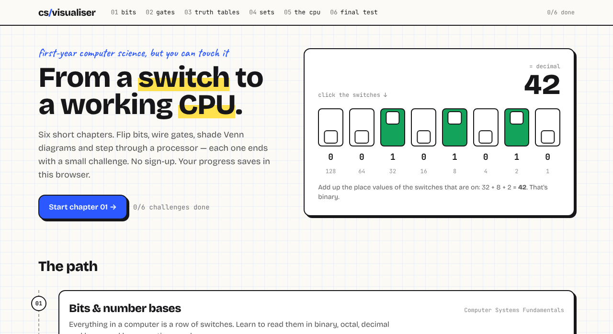
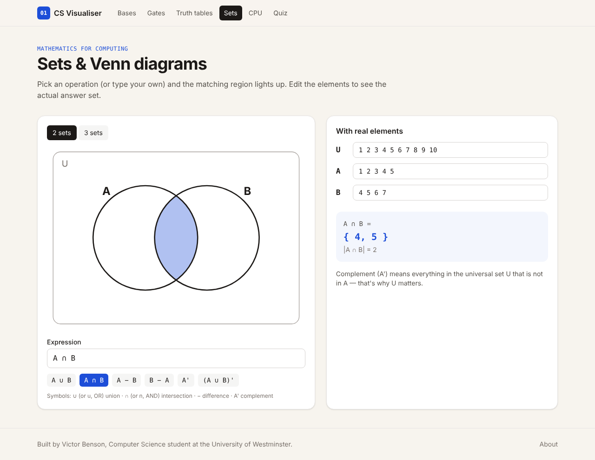
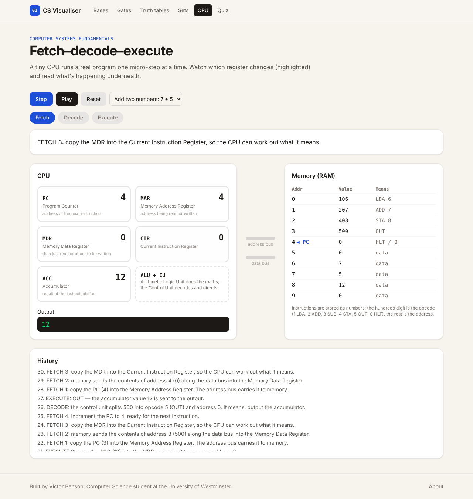

# CS Visualiser

Interactive revision tools for first-year Computer Science — built for the University of Westminster modules
**Mathematics for Computing** and **Computer Systems Fundamentals**, useful for any first-year CS course.



**Live:** https://cs-visualiser.vercel.app

## How it works

It's a path in six chapters, from a single bit to a working CPU. Each chapter ends with a **challenge** (write 173 in binary, build XOR from AND/OR/NOT, predict what the CPU outputs…). Finishing one ticks it off, and progress is saved in your browser.

## Chapters

| Tool | What it does |
| --- | --- |
| **Number bases** | Type a number in binary, octal, decimal or hex; see all four live, with the working (place values and repeated division) and two's complement for negatives. |
| **Logic gates** | Drag AND, OR, NOT, NAND, NOR and XOR onto a board, wire them up, flip switches and watch the lamps. The truth table is generated from your circuit. Examples: half adder, XOR from NANDs, majority vote. |
| **Truth table builder** | Type an expression like `(A AND B) OR NOT C` (or `A' + B`) and get the full table with working columns. |
| **Sets & Venn diagrams** | Shade union, intersection, difference and complement for 2 or 3 sets, and compute the answer with real elements. |
| **Fetch–decode–execute** | Step through a tiny accumulator CPU running a real program; PC, MAR, MDR, CIR and ACC light up as they change. |
| **Final test** | 10 questions across every chapter. Numbers are randomised, so it's different each time. Score 8+ to finish. |

| | |
| --- | --- |
|  |  |

## Stack

React 19 · TypeScript · Vite · Tailwind CSS v4 · React Router. No backend — everything runs in the browser. Hosted on Vercel.

## Run it

```bash
npm install
npm run dev     # http://localhost:5173
npm run build   # production build in dist/
```

## How it's organised

```
src/
  lib/        the logic, with no UI: boolean.ts (expression parser), bases.ts, cpu.ts, quiz.ts
  pages/      one file per tool
  components/ layout, nav and the tool list
```

The Boolean parser is shared by the truth table builder and the sets tool (∪ = OR, ∩ = AND, ' = complement).

## Adding a topic

Screenshot a lecture slide you find hard, add a page in `src/pages/`, register it in `src/components/tools.ts` and `src/App.tsx`.

Built by Victor Benson — [GitHub](https://github.com/macroer16) · [LinkedIn](https://www.linkedin.com/in/victor-benson-b2a07b283/)
